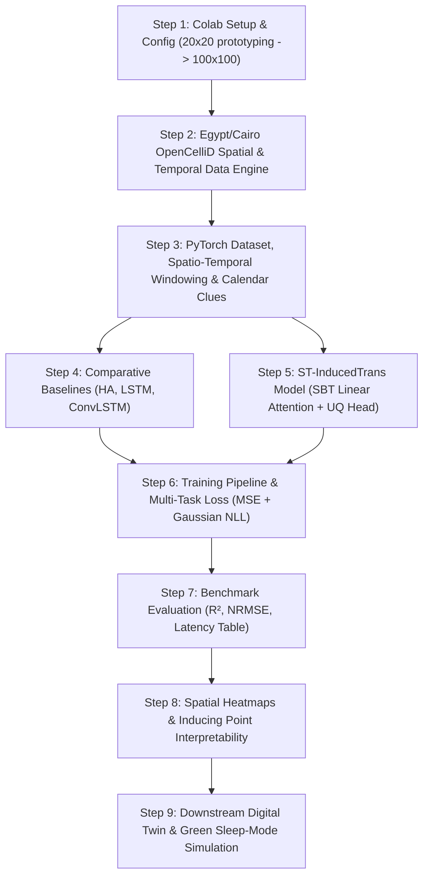

# ST-InducedTrans: Cellular Traffic Forecasting & RAN Optimization
## Master Implementation Blueprint & Colab Step-by-Step Specification

This document is the **official, self-contained implementation specification** for building the **ST-InducedTrans** framework in a single Jupyter Notebook (`cellular_load_forecasting_st_inducedtrans.ipynb`) on **Google Colab** using **PyTorch**.

> **Note for AI Assistant (e.g., GLM):**
> Follow the **Step-by-Step Prompting Protocol** in Section 1. Do **NOT** dump the entire notebook at once. Output **one single step at a time**, verify tensor dimensions with print statements, and ensure every dependency is compatible with standard Google Colab (no custom compilation or complex wheels required).

---

## 1. Execution Protocol for Step-by-Step Implementation

1. **One Step per Response:** Implement code for one designated section at a time.
2. **Standard Google Colab Dependencies Only:**
   * Core: `torch`, `torch.nn`, `torch.utils.data`
   * Numerical & Analysis: `numpy`, `pandas`, `scipy`, `scikit-learn`
   * Visualization: `matplotlib`, `seaborn`
3. **Deterministic & Shape-Verified:**
   * Fix random seeds (`torch.manual_seed(42)`, `np.random.seed(42)`).
   * At the end of every code cell, include an explicit sanity check printing the shapes of created tensors or model outputs (e.g., `print(f"Output shape: {out.shape}")`).
4. **Device Agnostic:** Ensure all tensors and models use `device = torch.device('cuda' if torch.cuda.is_available() else 'cpu')`.

---

## 2. Project Architecture Workflow



---

## 3. Detailed Step-by-Step Specifications

### Step 1: Environment Setup, GPU Diagnostics & Central Config
* **Objective:** Initialize the notebook environment, configure GPU/CPU, and define a strongly-typed `Config` dataclass.
* **Config Parameters:**
  ```python
  class Config:
      # Spatial Grid
      grid_h: int = 20          # 20 for fast Colab prototyping (400 cells), 100 for Milan scale
      grid_w: int = 20
      num_cells: int = 400      # grid_h * grid_w
      num_services: int = 3     # 0: Internet (eMBB), 1: Voice Calls, 2: SMS

      # Temporal Lags
      c_closeness: int = 3      # Consecutive preceding hours [t-2, t-1, t]
      p_period: int = 3         # Preceding days [t-3*24, t-2*24, t-1*24]
      period_interval: int = 24 # 24 hours per day
      target_horizon: int = 3   # Future hours to predict [t+1, t+2, t+3]

      # ST-InducedTrans Hyperparameters
      k_inducing: int = 16      # Learnable inducing points (K << N)
      d_model: int = 64         # Feature representation dimension
      n_heads: int = 4          # Multi-head attention heads
      d_ff: int = 128           # Feedforward network hidden dim
      dropout: float = 0.1

      # Training
      batch_size: int = 16
      lr: float = 1e-3
      epochs: int = 15          # Sufficient for demonstration and benchmark
      device: str = "cuda" if torch.cuda.is_available() else "cpu"
  ```
* **Verification:** Print GPU model, CUDA availability, and configuration summary.

---

### Step 2: Data Engine — Egyptian Cellular Topology & Realistic Traffic Generator
* **Objective:** Create a self-contained, out-of-the-box data pipeline combining real Greater Cairo / Giza base station spatial density with realistic Egyptian telecommunication dynamics.
* **Spatial Topology ($X_{\text{BS}}$):**
  * Cairo geographic bounds: Latitude $29.80^\circ$ to $30.20^\circ$ N, Longitude $31.10^\circ$ to $31.45^\circ$ E.
  * Models base station density clusters matching Cairo hotspots: Downtown / Tahrir, New Cairo / 5th Settlement, Smart Village / 6th of October, and Giza.
* **Egyptian Temporal Profiles:**
  * 60 days of hourly traffic ($T = 60 \times 24 = 1,440$ steps).
  * **Internet (eMBB):** Daytime commuter spikes + heavy evening leisure streaming (20:00 - 23:00).
  * **Voice Calls / SMS:** Peaking during Egyptian business hours (09:00 - 17:00).
  * **Egyptian Calendar Nuances:** Sunday–Thursday workweek, Friday–Saturday weekend leisure shift.
* **Milan Dataset Compatibility:** Loader stub provided for swapping in raw Telecom Italia Milan CSVs/matrices if downloaded.
* **Verification:** Generate traffic tensor of shape `(T, H, W, num_services)` and plot the base station density map and a 7-day multi-service timeline.

---

### Step 3: Spatio-Temporal Windowing, Calendar Clues & PyTorch DataLoader
* **Objective:** Construct clean sliding windows and encode calendar clues without lookahead leakage.
* **Mathematical Tensor Signatures:**
  * **Closeness Input:** $X_c(t) \in \mathbb{R}^{B \times N \times c \times C}$ (lag $c=3$).
  * **Periodical Input:** $X_p(t) \in \mathbb{R}^{B \times N \times (p \cdot c) \times C}$ (past $p=3$ days).
  * **Calendar Clues ($\tau$):**
    * Cyclical hour-of-day: $\sin(2\pi h / 24), \cos(2\pi h / 24)$.
    * Day-of-week: $\sin(2\pi w / 7), \cos(2\pi w / 7)$ (accounting for Egypt weekend).
    * Holiday indicator: binary $\{0, 1\}$.
    * Vector dimension: $d_{\tau} = 5$.
  * **Target Tensor:** $\hat{X}_{\text{target}}(t) \in \mathbb{R}^{B \times N \times c \times C}$.
* **Train / Val / Test Split:** Strictly chronological 70% / 15% / 15%.
* **Verification:** Instantiate PyTorch `Dataset` and `DataLoader`, fetch a batch, and print all tensor shapes.

---

### Step 4: Baseline Models Implementation in PyTorch
* **Objective:** Implement the benchmark baselines:
  1. **Daily-Period Average (DailyPeriodAvg):** Averages the target-aligned hours-of-day from the previous p days (daily period average; renamed from the original weekly "Historical Average" so its window aligns exactly with the forecast hours).
  2. **Cell-wise LSTM:** Standard `nn.LSTM` modeling sequential temporal dynamics per cell.
  3. **ConvLSTM2D:** Spatial-temporal recurrent cell using 2D convolutions inside LSTM gates to capture local neighborhood dynamics.
* **Verification:** Perform a forward pass with dummy batches for each baseline and verify output shapes equal `(B, N, target_horizon, C)`.

---

### Step 5: ST-InducedTrans Architecture (Core Contribution)
* **Objective:** Build the linear-complexity Spatial Bottleneck Transformer in PyTorch.
* **Architectural Components:**
  1. **Multi-Head Attention Block (MAB):**
     * Generalized cross-attention: $\text{MAB}(Q, K, V) = \text{LayerNorm}(H + \text{FFN}(H))$ where $H = \text{LayerNorm}(Q + \text{MHA}(Q, K, V))$.
  2. **Spatial Bottleneck Transformer (SBT):**
     * Learnable inducing points parameter: $I \in \mathbb{R}^{K \times D}$ ($K=16$).
     * **Information Compression:** $H_{\text{latent}} = \text{MAB}(Q=I, K=X, V=X) \in \mathbb{R}^{B \times K \times D}$. Complexity: $\mathcal{O}(KND)$.
     * **Correlation Retrieval:** $X_{\text{spatial}} = \text{MAB}(Q=X, K=H_{\text{latent}}, V=H_{\text{latent}}) \in \mathbb{R}^{B \times N \times D}$. Complexity: $\mathcal{O}(NKD)$.
     * Total spatial complexity is strictly **$\mathcal{O}(KND)$ (linear in grid size $N$)**.
  3. **Dual Temporal Attention Branches:**
     * Closeness Branch Transformer + Periodicity Branch Transformer.
     * Conditioning with Calendar Clues ($\tau$).
  4. **Uncertainty Quantification (UQ) Head:**
     * Output projection yielding **mean** $\mu \in \mathbb{R}^{B \times N \times c \times C}$ and **log-variance** $\log \sigma^2 \in \mathbb{R}^{B \times N \times c \times C}$.
* **Verification:** Forward pass with batch tensor and verify output shapes of $\mu$ and $\log \sigma^2$.

---

### Step 6: Training Pipeline & Uncertainty Loss Function
* **Objective:** Train models with risk-aware multi-task loss.
* **Loss Formulation (Gaussian Negative Log-Likelihood + MSE):**
  $$\mathcal{L}_{\text{UQ}} = \frac{1}{2} \sum \left( \log \sigma^2 + \frac{(y - \mu)^2}{\sigma^2} \right) + \lambda \cdot \text{MSE}(y, \mu)$$
* **Training Details:**
  * Optimizer: `torch.optim.AdamW(lr=1e-3, weight_decay=1e-4)`.
  * Scheduler: `torch.optim.lr_scheduler.CosineAnnealingLR`.
  * Model checkpointing based on best validation NRMSE.
* **Verification:** Train for 5–10 epochs, displaying epoch-by-epoch train/val loss curves.

---

### Step 7: Benchmark Evaluation & Comparative Summary
* **Objective:** Evaluate test set performance and generate a direct comparison table.
* **Evaluation Metrics:**
  * Coefficient of Determination ($R^2$) for Internet and Call traffic.
  * Normalized Root Mean Square Error (NRMSE): $\frac{\text{RMSE}}{\max(y) - \min(y)}$ or $\frac{\text{RMSE}}{\text{mean}(y)}$.
  * Mean Absolute Error (MAE).
  * Inference Latency (milliseconds per sample on GPU).
* **Verification:** Render a formatted Pandas DataFrame comparing HA, LSTM, ConvLSTM, and ST-InducedTrans.

---

### Step 8: Spatial Visualizations & Attention Interpretability
* **Objective:** Produce visual evidence of the model's accuracy and spatial reasoning.
* **Plots:**
  1. **City Heatmaps:** Side-by-side 2D spatial maps: Ground Truth vs. Predicted vs. Absolute Error.
  2. **UQ Confidence Envelopes:** Line plot of traffic over a 24-hour horizon showing the predicted mean $\mu$ bounded by $\pm 2\sigma$ confidence intervals.
  3. **Inducing Point Spatial Projections:** Visualize the attention weights from the $K=16$ inducing points back onto the Cairo grid to observe learned functional zones (e.g., commercial vs. residential).

---

### Step 9: Downstream Digital Twin & Green Energy Sleep-Mode Simulation
* **Objective:** Demonstrate the operational value of proactive forecasts in 5G/6G RAN.
* **Simulation Mechanics:**
  1. **Physical Resource Block (PRB) Allocation:**
     * Compare reactive allocation (causes packet buffer overflows during sudden spikes) vs. proactive ST-InducedTrans allocation.
  2. **Safe Green Energy Savings (Sleep Modes):**
     * During forecasted low-traffic troughs (e.g., 03:00 - 06:00), micro-cell transceivers are placed into low-power sleep mode.
     * Uses UQ confidence bounds: only sleep if $\mu + 2\sigma < \text{Threshold}_{\text{sleep}}$.
     * Measure total energy saved (%) and SLA violation rate (0%).
* **Verification:** Plot energy consumption curve and SLA violation comparisons.

---

## 4. Prompting Template to Hand Off to GLM

When instructing GLM, use this prompt:

> *"We are implementing the ST-InducedTrans cellular traffic forecasting framework in a single Jupyter Notebook on Google Colab using PyTorch, based on the blueprint in `project_plan.md`. Please do NOT generate the entire project at once. Let's work step-by-step. Start by implementing **Step 1: Environment Setup, GPU Diagnostics & Central Config**. Provide the complete, clean code cell with tensor shape verifications and explain what it does."*
